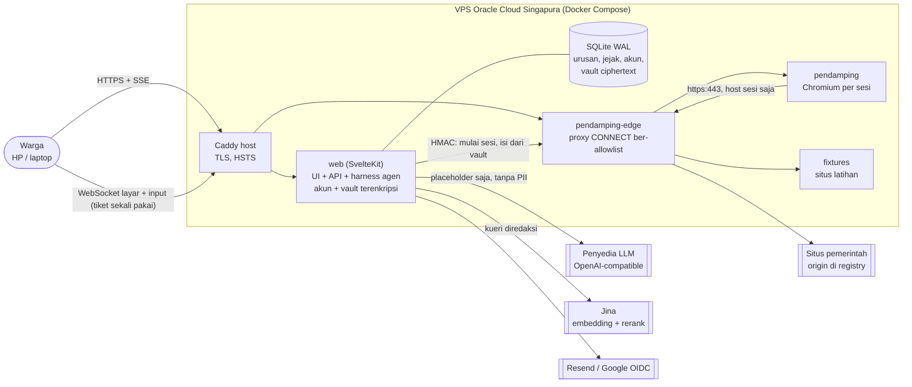

# Urusin

[](https://github.com/bynguts/urusin/actions/workflows/ci.yml)
[](https://github.com/bynguts/urusin/actions/workflows/release.yml)
[](https://github.com/bynguts/urusin/actions/workflows/security.yml)

<!-- Badge coverage sengaja tidak ada: angka coverage dihitung CI per paket (job "Coverage") tetapi belum dipublikasikan sebagai badge. -->

Agen AI yang ikut mengurus layanan administrasi kependudukan bersama warga. Urusin membaca syarat dari sumber
resmi, menyusun langkahnya, lalu mengisi formulir di situs resmi lewat **Browser Pendamping**. Login, OTP,
CAPTCHA, dan **tombol Kirim terakhir selalu ditekan warga sendiri**.

- **Aplikasi langsung:** <https://urusinai.web.id>
- **Masuk tanpa akun:** buka aplikasi lalu pilih "Coba tanpa daftar", atau "Masuk sebagai juri" di halaman Masuk
  (lihat [§7](#7-akun-demonstrasi)).

## 1. Nama tim dan anggota

**Tim Urusin.**

| Peran                                                | Anggota                        | Kampus                      | GitHub                                     |
| ---------------------------------------------------- | ------------------------------ | --------------------------- | ------------------------------------------ |
| Ketua: harness agen, AI/LLM, RAG, akun, VPS          | Muhammad Muqorrobin Al Anshori | President University        | [@bynguts](https://github.com/bynguts)     |
| Anggota: UI/UX, adapter layanan & kota, fixture, e2e | Rafi Cahya Mahardika           | Universitas Negeri Surabaya | [@rafilajhh](https://github.com/rafilajhh) |

## 2. Kategori, nama aplikasi, deskripsi, masalah, dan target pengguna

- **Kategori:** Web (aplikasi web responsif, dirancang untuk HP lebih dulu).
- **Nama aplikasi:** Urusin.
- **Subtema:** Civic Tech & Community Service.
- **Masalah.**
  - Indonesia punya 514 kabupaten/kota (Kepmendagri 300.2.2-2138/2025, `data/wilayah/kabkota.json`), dan
    layanan adminduk (akta, KK, KTP-el, pindah) dilayani Disdukcapil masing-masing. Setiap daerah punya portal,
    syarat, dan alurnya sendiri.
  - Warga yang sedang mengalami peristiwa hidup (kelahiran, kematian, perkawinan, pindah) harus mencari sendiri
    portal yang benar, membaca syarat yang tersebar, dan mengisi formulir panjang. Ini paling berat bagi perantau
    yang KTP-nya masih di kampung, warga lansia, dan warga yang hanya punya HP.
  - Kesalahan kecil (berkas kurang, situs palsu, kolom salah) membuat warga bolak-balik ke kantor.
- **Solusi.**
  - Warga cukup bercerita ("anak saya baru lahir di Wonogiri"). Urusin menentukan layanan dan daerah, lalu
    menyusun langkah dan daftar berkas dari sumber resmi, dengan kutipan yang bisa dibuka.
  - Data Diri dan dokumen disimpan sekali, lalu formulir di situs resmi diisi oleh Browser Pendamping yang
    layarnya tampil di HP atau laptop warga. Warga sendiri yang memeriksa dan menekan Kirim.
  - Bila daerah belum didukung atau situsnya menolak otomasi, Urusin beralih ke **mode dipandu** dengan
    langkah manual dan kanal resmi, tanpa mengarang jawaban.
- **Target pengguna:** perantau, keluarga yang sedang mengurus peristiwa hidup, dan warga lansia (lewat anggota
  keluarga sebagai pendamping). Prioritasnya HP kelas menengah ke bawah dan koneksi lambat.

## 3. Fitur utama

Semua fitur di bawah sudah berjalan di <https://urusinai.web.id> dan diuji di CI.

- **Percakapan agen berbahasa Indonesia.**
  - Empat Peristiwa Hidup (Kelahiran, Kematian, Perkawinan, Pindah) dan "Urusan lain".
  - Agen menanyakan hal yang kurang, mengusulkan rencana, dan meminta persetujuan sebelum setiap aksi tulis.
  - Respons dialirkan lewat SSE.
- **Jawaban berdasar sumber resmi (RAG hibrida).**
  - Setiap klaim membawa kutipan persis yang diverifikasi terhadap potongan sumber. Chip kutipan membuka halaman
    resminya dengan sorotan (Text Fragment).
  - Pertanyaan di luar cakupan dijawab dengan **abstain** dan dialihkan ke kanal resmi, bukan dikarang.
- **Router 514 kabupaten/kota.**
  - Daerah ditentukan dari prefiks NIK atau pilihan warga.
  - Kontak Disdukcapil setiap daerah, dan status dukungan portal yang jujur per daerah: `kirim-asli`, `read-only`,
    `pending-recon`, atau `tidak-ada-portal`.
- **Browser Pendamping (satu-satunya eksekutor).**
  - Satu Chromium per sesi di server. Layarnya dialirkan ke HP/laptop warga, jadi bisa dipakai di HP tanpa
    memasang apa pun.
  - AI mengisi kolom dan mengunggah berkas. Login, OTP, CAPTCHA, verifikasi situs, dan tombol Kirim diserahkan
    ke warga (mode _takeover_).
  - Setelah Kirim, nomor registrasi dibaca dari halaman untuk cek status.
- **"Izinkan isi".** Sebelum mengisi, warga melihat daftar data yang akan ditulis dan situs tujuannya.
  - Persetujuan berlaku sekali dan hanya untuk origin itu.
  - Nilai diambil server langsung dari vault, tidak pernah lewat peramban atau model.
- **Akun opsional.** Tanpa akun (mode tamu) semua fitur tetap jalan.
  - Dengan akun (email + kata sandi, atau Google), Data Diri, dokumen, dan daftar urusan ikut ke perangkat lain.
  - Fitur akun: verifikasi email, lupa sandi, keluar dari semua perangkat, tautkan/lepas Google, dan hapus
    akun.
- **Brankas terenkripsi.**
  - Data Diri (NIK, KK, alamat, HP) dan dokumen (foto KTP/KK, PDF) dienkripsi AES-256-GCM dengan kunci per
    pemilik.
  - Membuka brankas di perangkat baru meminta masuk ulang. Hapus = _crypto-shred_.
- **Jejak.** Linimasa setiap urusan dengan rantai hash; rantainya berubah merah bila data dimanipulasi. Layar
  Browser Pendamping juga punya tampilan "Lihat apa yang dilihat AI".
- **Aksesibilitas.**
  - Teks besar dan target sentuh ≥ 48 px.
  - Tombol "Bacakan" (sintesis suara peramban, tanpa jaringan).
  - Mode terang/gelap.
- **Situs latihan (fixtures).** Replika jinak portal daerah di <https://fixtures.urusinai.web.id> untuk demo dan
  e2e, supaya uji coba tidak pernah mengirim apa pun ke situs pemerintah.

## 4. Teknologi

| Lapisan            | Yang dipakai                                                                                                                                             |
| ------------------ | -------------------------------------------------------------------------------------------------------------------------------------------------------- |
| Bahasa & monorepo  | TypeScript (strict), Node.js 26, pnpm 11, Turborepo                                                                                                      |
| Web                | SvelteKit 3 + Svelte 5, `@sveltejs/adapter-node`, Vite 8, Tailwind CSS 4                                                                                 |
| Agen (harness)     | Harness sendiri di atas Chat Completions (`@urusin/harness`): state machine urusan, tool bertipe zod, policy gate, spotlighting, audit berantai          |
| Browser Pendamping | Chromium headed di Xvfb via Playwright + CDP screencast → WebSocket → `<canvas>`; interpreter DSL langkah (`@urusin/executor`) dan program adapter situs |
| Basis data         | SQLite (`better-sqlite3`, mode WAL). BM25 lewat FTS5; vektor dengan cosine di JS di atas blob SQLite (bukan `sqlite-vec`)                                |
| Kriptografi & akun | `node:crypto` (argon2id bawaan Node, AES-256-GCM, HKDF), `jose` (verifikasi ID token Google OIDC)                                                        |
| Validasi & kontrak | zod 4, `@urusin/contracts` (skema event SSE dan endpoint, dibekukan setelah tag `contracts-take1`)                                                       |
| Egress             | `undici` dengan allowlist host dan pemeriksaan alamat (`@urusin/egress`): semua HTTP keluar server lewat satu pintu                                      |
| Situs latihan      | Hono (`apps/fixtures`)                                                                                                                                   |
| Pengujian          | Vitest, Playwright, `node:test` untuk skrip repositori, Lighthouse CI                                                                                    |
| Kualitas           | ESLint (flat config), Prettier, commitlint, husky (pre-commit: pemindai PII/secret)                                                                      |
| CI/CD & hosting    | GitHub Actions, image multi-arch di GHCR ditarik berdasarkan digest, Docker Compose di VPS Oracle Cloud (Singapura, arm64), Caddy milik host             |
| API & layanan luar | LLM OpenAI-compatible (SDK `openai`), Jina (embedding + rerank), Google OIDC, Resend (email), Cloudflare Turnstile                                       |

## 5. Arsitektur sistem dan alur data



**Alur satu urusan:**

1. Warga bercerita di web app. Harness menentukan intent dan daerah (router NIK), lalu mencari syarat lewat RAG
   (BM25 + vektor, RRF, rerank, gerbang abstain).
2. Model hanya melihat **placeholder** seperti `{{PEMOHON.NIK}}`. Teks halaman dan hasil tool masuk prompt
   sebagai data tak tepercaya (spotlight + datamark). Guard `noPlaceholder()` dan policy gate menolak parameter
   tool yang memuat PII atau aksi di luar state.
3. Untuk mengisi, warga menekan **"Izinkan isi"**. Peramban hanya mengirim `{writeList, targetOrigin}`; server
   menerbitkan persetujuan sekali pakai yang terikat pemilik, daftar kolom, dan origin.
4. Browser Pendamping membuka situs resmi. Program adapter (DSL `nav/fill/upload/verify/gate.human`) mengisi
   kolom dengan nilai dari vault, hanya bila origin halaman hidup sama persis dengan origin persetujuan.
5. Login, OTP, CAPTCHA, dan Kirim dikerjakan warga lewat takeover. Runner menolak mengklik target `gate.human`
   (`FINAL_NOT_AUTOMATABLE`). Bukti (nomor registrasi) dibaca dari halaman dan dicatat di Jejak.

**Di mana data tinggal:**

- **Tanpa akun (tamu):** Data Diri dan dokumen disimpan terenkripsi di server, terikat cookie sesi perangkat ini,
  dan terhapus otomatis 72 jam sejak dibuat. Daftar urusan dan preferensi ada di penyimpanan peramban.
- **Dengan akun:** vault terenkripsi di server per akun (AES-256-GCM, DEK per pemilik dibungkus KEK dari env
  host), sehingga ikut ke perangkat lain.
- Tabel harness, log, dan model tidak pernah menerima NIK, KK, HP, atau email mentah.

Detail C4 (konteks, kontainer), pipeline pengiriman, dan diagram urutan PII ada di
[`docs/arsitektur.md`](docs/arsitektur.md). Keputusan desain ada di [`docs/adr/`](docs/adr/README.md).

| Bagian                        | Lokasi                                                                                    |
| ----------------------------- | ----------------------------------------------------------------------------------------- |
| Web app, API, broker sesi     | `apps/web`                                                                                |
| Browser Pendamping            | `apps/pendamping`, `packages/executor`, `packages/adapters`, `packages/pendamping-client` |
| Situs latihan                 | `apps/fixtures`                                                                           |
| Agen, state machine, eval     | `packages/harness`                                                                        |
| Akun, sesi, vault             | `packages/akun`                                                                           |
| RAG                           | `packages/rag`, data di `data/`                                                           |
| Router kab/kota               | `packages/registry`                                                                       |
| Gateway LLM, capability probe | `packages/llm`                                                                            |
| Allowlist HTTP keluar         | `packages/egress`                                                                         |
| Step DSL, guard PII, registry | `packages/core`                                                                           |
| Kontrak API/SSE               | `packages/contracts`                                                                      |
| Deploy                        | `deploy/` (Compose, snippet Caddy, skrip deploy/backup)                                   |

## 6. Instalasi, konfigurasi, dan menjalankan

**Prasyarat:** Node.js 26 (lihat `.nvmrc`) dan pnpm 11. Browser Pendamping juga butuh Chromium Playwright
(`pnpm exec playwright install chromium`) dan, di Linux, Xvfb.

```bash
pnpm install                 # memasang dependensi dan hook commit
cp .env.example .env         # isi nilai sendiri; .env tidak pernah di-commit
pnpm build                   # build semua paket
pnpm --filter @urusin/web dev   # http://localhost:5173
```

Tanpa kunci apa pun aplikasi berjalan dalam **mode demo**:

- agen memakai `DemoProvider` (skenario tetap, tanpa jaringan);
- RAG memakai korpus contoh;
- email ditulis ke log;
- vault memakai kunci acak per proses (data hilang saat restart; produksi wajib `URUSIN_PII_KEY`);
- tombol juri berjalan tanpa Turnstile.

Isi variabel di bawah untuk fitur penuh. Daftar lengkap dan penjelasannya ada di [`.env.example`](.env.example).

| Fitur                   | Variabel                                                                                                     |
| ----------------------- | ------------------------------------------------------------------------------------------------------------ |
| Agen dengan LLM nyata   | `LLM_BASE_URL`, `LLM_API_KEY`, `LLM_AGENT_MODEL` (opsional `LLM_CAPS_PIN`, `LLM_FORCE_NO_*`)                 |
| RAG korpus nyata        | `URUSIN_RAG_DB` (hasil `pnpm rag:ingest`), `LLM_EMBED_*`, `RERANK_*`, `RAG_ABSTAIN_MIN_*`                    |
| Vault & akun (produksi) | `URUSIN_PII_KEY` (wajib, base64 32 byte), `URUSIN_PII_KEY_PREV` (rotasi), `SESSION_SECRET`, `URUSIN_VAULT_*` |
| Email                   | `URUSIN_EMAIL_MODE`, `RESEND_API_KEY`, `URUSIN_EMAIL_FROM`                                                   |
| Masuk dengan Google     | `GOOGLE_CLIENT_ID`, `GOOGLE_CLIENT_SECRET`, plus redirect URI untuk setiap host di `deploy/hosts.json`       |
| Turnstile (juri, login) | `TURNSTILE_SITE_KEY`, `TURNSTILE_SECRET_KEY`                                                                 |
| Kuota dan biaya         | `URUSIN_LIMIT_*`, `URUSIN_TAMU_PER_IP_HARI`, `URUSIN_DEMO_*`, `URUSIN_DAILY_USD_CAP`, `URUSIN_DAILY_IDR_CAP` |
| Browser Pendamping      | `PENDAMPING_*` (URL worker, rahasia HMAC, batas sesi dan memori)                                             |
| Situs latihan           | `FIXTURES_PROFILE`, `FIXTURES_PORT`, `FIXTURES_PUBLIC_ORIGIN`                                                |

Perintah lain:

```bash
pnpm lint && pnpm typecheck && pnpm test    # sama dengan CI
pnpm e2e                                    # Playwright (web dan pendamping)
pnpm coverage                               # coverage per paket dengan ambang
pnpm budget                                 # anggaran JS awal per rute (≤ 70 KB gzip)
pnpm rag:ingest && pnpm rag:eval            # bangun korpus RAG dan ukur retrieval
pnpm eval --k 5                             # eval agen pass^k (butuh env LLM)
pnpm kek:rotate                             # rotasi kunci vault
```

Deploy produksi (image dari GHCR berdasarkan digest, blue/green di belakang Caddy host) dijelaskan di
[`deploy/README.md`](deploy/README.md).

## 7. Akun demonstrasi

Juri **tidak butuh kredensial**:

- Halaman Masuk → **"Masuk sebagai juri"**.
  - Membuat salinan demo terisolasi berisi Data Diri sintetis (bukan data orang sungguhan), berlaku 24 jam.
  - Setiap klik mendapat salinannya sendiri, jadi juri tidak saling menimpa data.
  - Batas 3 salinan per IP per hari dan 200 salinan aktif. Salinan yang kedaluwarsa langsung membebaskan
    tempat.
  - Data sintetis hanya boleh diisikan ke situs latihan (<https://fixtures.urusinai.web.id>), tidak pernah ke
    situs pemerintah.
- **"Coba tanpa daftar"** (mode tamu) membuka semua fitur tanpa akun.

Tidak ada sandi demo yang dipublikasikan. Situs pemerintah selalu memakai akun pribadi warga dan tidak pernah
dibagikan.

## 8. Dokumentasi penggunaan AI

**AI di dalam produk:**

| Bagian produk                                      | Layanan / model                                                                                                                                             |
| -------------------------------------------------- | ----------------------------------------------------------------------------------------------------------------------------------------------------------- |
| Agen percakapan: intent, rencana, pemanggilan tool | LLM lewat proxy OpenAI-compatible tim, model `pythia` (probe 2026-11-08: dijawab `gpt-6.1-terra`, lihat [`docs/provider-probe.md`](docs/provider-probe.md)) |
| Embedding RAG                                      | Jina `jina-embeddings-v5-omni-small` (task `retrieval.query` / `retrieval.passage`)                                                                         |
| Rerank RAG                                         | Jina `jina-reranker-v3`                                                                                                                                     |
| Pengisian formulir                                 | Tidak memakai model: program adapter deterministik di Browser Pendamping, nilai dari vault                                                                  |

- Gateway (`@urusin/llm`) memakai SDK `openai` ke endpoint OpenAI-compatible mana pun.
  - Capability probe saat boot. Bila tool, JSON schema, atau stream tidak didukung, agen turun bertahap ke mode
    yang lebih sederhana.
  - Meter biaya per urusan dan batas harian (`URUSIN_DAILY_*_CAP`).
- **Kualitas retrieval terukur** pada jalur agen yang di-deploy (`pnpm rag:eval-agent`, 2026-11-09):

  | Jalur agen                 | held-out recall@3 | held-out abstain presisi / recall |
  | -------------------------- | ----------------: | --------------------------------: |
  | BM25 saja                  |             78,6% |                      100% / 66,7% |
  | Hybrid + rerank (produksi) |              100% |                       100% / 100% |

  Held-out terdiri dari 14 pertanyaan dalam cakupan dan 6 di luar cakupan. Metodologi, set tuning, dan seleksi
  model ada di [`packages/rag/README.md`](packages/rag/README.md).

- **Keamanan AI.**
  - Suite prompt injection: 10 kasus lewat 5 kanal (RAG, output tool, DOM, OCR, berkas warga) dijalankan
    dengan model yang **sengaja patuh**. Tingkat keberhasilan serangan untuk aksi tulis/final = 0%, karena
    yang memblokir adalah policy gate, bukan kepatuhan model.
  - Teks dari luar selalu dibungkus spotlight + datamark.
- Model tidak pernah melihat NIK, KK, nomor HP, atau email. Kueri dan dokumen diredaksi (`[DATA]`) sebelum
  dikirim ke embedding dan rerank.

**AI saat pengembangan:**

- Kami memakai AI coding assistant (Claude Code) untuk membantu menulis dan meninjau kode, tes, konfigurasi,
  dan dokumentasi.
- Setiap perubahan ditinjau, diuji, dan di-commit oleh anggota tim dari akun GitHub masing-masing.
- Trailer co-author otomatis dimatikan, dan penggunaan AI diungkap di bagian ini.

## 9. Atribusi

- **Dataset:**
  - Kode dan nama wilayah: Kepmendagri 300.2.2-2138 Tahun 2025 (diubah dengan 300.2.2-2430/2025), diambil
    lewat mirror [cahyadsn/wilayah](https://github.com/cahyadsn/wilayah) (MIT) dan dicocokkan dengan
    [yonatanyl/KODE-WILAYAH-KEPMENDAGRI-2025](https://github.com/yonatanyl/KODE-WILAYAH-KEPMENDAGRI-2025).
    Detail di `data/wilayah/kabkota.json`.
  - Korpus RAG: 37 halaman dan dokumen resmi (Dukcapil, Disdukcapil daerah, regulasi) beserta URL dan tanggal
    aksesnya di `data/sources.json`.
  - Kontak Disdukcapil: `data/wilayah/kontak-dukcapil.json`, dengan URL sumber per entri.
  - Glosarium istilah: `data/glossary/`, merujuk sumber di `data/sources.json`.
- **Aset desain:**
  - Desain UI, token, ilustrasi maskot, dan logo dibuat oleh Rafi Cahya Mahardika di pen.dev.
  - Font **Strawberry Sans** (`apps/web/src/lib/assets/fonts/`).
- **Pustaka sumber terbuka utama:** SvelteKit, Svelte, Vite, Tailwind CSS, Playwright, Hono, better-sqlite3,
  zod, `openai` (SDK resmi), jose, undici, Turborepo, Vitest, ESLint, Prettier, commitlint, husky. Versi
  lengkap ada di `pnpm-lock.yaml`.
- **Layanan pihak ketiga:** penyedia LLM OpenAI-compatible, Jina AI, Google Identity (OIDC), Resend,
  Cloudflare Turnstile, GitHub Actions/GHCR, Oracle Cloud.
- Tidak memakai template proyek pihak ketiga.

## Keamanan, privasi, dan etika

- **Warga yang menekan Kirim.**
  - Agen tidak pernah mengirim formulir, login, atau menyelesaikan CAPTCHA.
  - Tanpa plugin stealth, tanpa layanan pemecah CAPTCHA, tanpa proxy residensial, dan user agent jujur
    ([ADR 0025](docs/adr/0025-executor-tanpa-bypass-captcha.md)).
  - Tantangan verifikasi situs diserahkan ke warga. Bila situs memblokir, Urusin beralih ke mode dipandu dengan
    pesan jujur.
- **UU PDP (UU 27/2022).**
  - Persetujuan saat mendaftar.
  - Hak akses, perbaikan, dan penghapusan lewat UI dan API.
  - Retensi terbatas: tamu 72 jam, salinan juri 24 jam, akun belum terverifikasi 24 jam.
  - Pengungkapan pemroses dan transfer lintas negara: Resend (AS), Google, Oracle Cloud Singapura. DPIA ada di
    [ADR 0028](docs/adr/0028-akun-dan-login.md).
- **Akun.**
  - Sandi argon2id, minimal 10 karakter, ditolak bila termasuk 10.000 sandi umum.
  - Sesi di cookie `__Host-` (HttpOnly, Secure, SameSite=Lax); server hanya menyimpan hash token.
  - Kunci bertahap setelah gagal login (30 detik, berlipat sampai 1 jam), dicatat atomik.
  - Google OIDC dengan PKCE/state/nonce. Menautkan Google butuh email terverifikasi dan masuk ulang ≤ 15 menit.
- **Vault.**
  - AES-256-GCM dengan DEK per pemilik yang dibungkus KEK (`URUSIN_PII_KEY`), plus AAD berversi.
  - Hapus = crypto-shred.
  - Batas penyimpanan per pemilik, per tamu, dan global agar disk tidak bisa dipenuhi.
- **Browser Pendamping.**
  - Konteks Chromium non-persisten per sesi, dihancurkan setelah selesai, 15 menit, atau 3 menit idle.
  - Ketikan warga saat takeover tidak dicatat.
  - Kontainer di jaringan internal tanpa rute keluar. Satu-satunya jalan keluar adalah proxy edge yang hanya
    mengizinkan https:443 ke host sesi dan menolak alamat privat/metadata.
  - Sandbox Chromium aktif, kontainer non-root, filesystem read-only
    ([ADR 0028 Browser Pendamping](docs/adr/README.md)).
- **Web.**
  - CSP SvelteKit mode `auto` (nonce/hash), `frame-ancestors 'none'`, laporan CSP.
  - Semua HTTP keluar lewat allowlist `@urusin/egress`.
- **Rantai pasok.**
  - Semua action dipin ke SHA.
  - OSV-Scanner, `pnpm audit --prod`, CodeQL, OpenSSF Scorecard.
  - Hook pre-commit dan CI memindai NIK, HP, email, dan private key. Rahasia hanya di `.env`.
- Kebijakan pelaporan kerentanan: [`SECURITY.md`](SECURITY.md).

## Pengujian dan CI

- Lebih dari 1.200 tes unit (Vitest) di 10 paket, ditambah e2e Playwright: alur akun, unduh di perangkat baru,
  Google lewat IdP tiruan, dan Browser Pendamping terhadap situs latihan.
- **CI (`.github/workflows/ci.yml`):**
  - lint, format, typecheck, test, build;
  - anggaran bundle;
  - audit riwayat commit (conventional, tanpa atribusi AI, author terdaftar);
  - pemindai PII;
  - e2e;
  - coverage dengan ambang per paket (mis. `registry` 100% baris, `egress`/`llm` 95%, `akun`/`rag` 90%);
  - Lighthouse CI mobile (performance ≥ 0,90, aksesibilitas ≥ 0,95, total ≤ 250 KiB);
  - kompatibilitas image rilis kandidat dan pembekuan kontrak.
- **Release:** setiap push ke `main` membangun image `linux/amd64` + `linux/arm64` ke GHCR. VPS menarik image
  berdasarkan digest dan memeriksa `/api/health` sebelum mengalihkan trafik.

## Efisiensi sumber daya

- JS awal per rute ≤ 70 KB gzip (`pnpm budget`), total transfer per rute ≤ 250 KiB (Lighthouse CI), font sendiri satu berkas
  woff2, ikon SVG inline.
- Browser Pendamping: sekitar 213 MB idle dan 170–210 MB tambahan per sesi (diukur di kontainer).
  - Sesi aktif dibatasi (bawaan 2) dengan antrean.
  - Worker tambahan bisa berjalan di laptop anggota lewat Tailscale.
- Biaya LLM dicatat per urusan dari `usage` dan dibatasi harian. Angka publik latensi dan biaya ada di
  `/api/transparansi`.

## Batasan yang diketahui

- **Situs pemerintah:**
  - Baru satu portal berstatus `kirim-asli` (Telunjuk Sakti Wonogiri) dan dua `read-only` (Surabaya,
    Semarang).
  - 20 daerah lain masih `pending-recon` dan memakai mode dipandu.
  - Situs `id-only` hanya bisa diisi dari worker berlokasi Indonesia.
- **Email** saat ini berjalan dalam mode log (Resend belum diaktifkan): email verifikasi dan atur ulang sandi
  belum terkirim ke warga. Masuk dengan Google, mode tamu, dan tombol juri tidak terpengaruh.
- **Input suara dan pengingat** (`URUSIN_FEATURE_VOICE`, `URUSIN_FEATURE_REMINDERS`) masih nonaktif.
- **Persetujuan "Izinkan isi"** disimpan di memori proses, jadi restart server berarti warga menekannya lagi.

## Dokumentasi

- [Arsitektur (C4 dan alur data PII)](docs/arsitektur.md)
- [Architecture Decision Records](docs/adr/README.md) (format MADR)
- [Kebijakan keamanan](SECURITY.md) (Indonesia dan English)
- [Panduan kontribusi](CONTRIBUTING.md)
- [Deploy di VPS](deploy/README.md)
- [RAG: pipeline dan evaluasi](packages/rag/README.md)
- [Kontrak API/SSE](packages/contracts/README.md)
- [Panduan UI](docs/ui/README.md), [UI akun](docs/ui/auth.md)

## Lisensi

[MIT](LICENSE) © 2026 Tim Urusin
