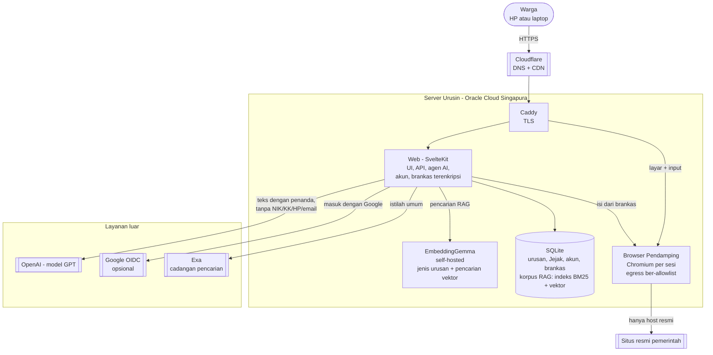

# Urusin

**Asisten AI yang menemani warga mengurus administrasi kependudukan, dari cerita pertama sampai formulir di situs
resmi terisi.** Warga cukup bercerita ("anak saya baru lahir di Wonogiri"). Urusin mengenali layanan dan daerahnya,
menyusun langkah dan daftar berkas dari sumber resmi, memeriksa foto dokumen, lalu membantu mengisi formulir di
portal pemerintah lewat **Browser Pendamping**. Login, OTP, CAPTCHA, dan tombol **Kirim** terakhir selalu dikerjakan
warga sendiri.

- **Web app:** <https://urusinai.web.id>
- **Video demo (YouTube, 3–5 menit):** **[TAUTAN VIDEO MENYUSUL]**
- **Akun demonstrasi:** halaman [Masuk](https://urusinai.web.id/masuk) → **Masuk sebagai juri**, tanpa kredensial
  (lihat [Akun demonstrasi](#8-akun-demonstrasi)).
- **Kode sumber:** <https://github.com/bynguts/urusin> (lisensi MIT).

## Daftar isi

1. [Tim](#1-tim)
2. [Kategori, masalah, solusi, dan target pengguna](#2-kategori-masalah-solusi-dan-target-pengguna)
3. [Fitur yang sudah berjalan](#3-fitur-yang-sudah-berjalan)
4. [Teknologi](#4-teknologi)
5. [Arsitektur sistem dan alur data](#5-arsitektur-sistem-dan-alur-data)
6. [Struktur repositori](#6-struktur-repositori)
7. [Instalasi, konfigurasi, dan menjalankan](#7-instalasi-konfigurasi-dan-menjalankan)
8. [Akun demonstrasi](#8-akun-demonstrasi)
9. [Dokumentasi penggunaan AI](#9-dokumentasi-penggunaan-ai)
10. [Atribusi](#10-atribusi)
11. [Keamanan, privasi, dan etika](#11-keamanan-privasi-dan-etika)
12. [Pengujian](#12-pengujian)
13. [Status dan batasan](#13-status-dan-batasan)

## 1. Tim

**Tim Lisan al-Gaib**

| Peran                                                      | Anggota                        | Kampus                      | GitHub                                     |
| ---------------------------------------------------------- | ------------------------------ | --------------------------- | ------------------------------------------ |
| Ketua: agen AI, RAG, akun dan keamanan, Browser Pendamping | Muhammad Muqorrobin Al Anshori | President University        | [@bynguts](https://github.com/bynguts)     |
| Anggota: desain UI/UX, adapter layanan dan kota, uji e2e   | Rafi Cahya Mahardika           | Universitas Negeri Surabaya | [@rafilajhh](https://github.com/rafilajhh) |

## 2. Kategori, masalah, solusi, dan target pengguna

- **Kategori:** Web (web app responsif, dirancang untuk HP lebih dulu, tanpa perlu memasang apa pun).
- **Nama web app:** Urusin.
- **Subtema:** 5. Civic Tech & Community Service.

### Masalah

- Indonesia punya 514 kabupaten/kota. Layanan administrasi kependudukan (akta kelahiran dan kematian, KK, KTP-el,
  pindah domisili) dilayani Disdukcapil masing-masing, dengan portal, syarat, dan alur yang berbeda-beda.
- Warga yang sedang mengalami peristiwa hidup harus mencari sendiri portal yang benar, membaca syarat yang tersebar,
  lalu mengisi formulir panjang. Ini paling berat bagi perantau yang KTP-nya masih di kampung, warga lansia, dan
  warga yang hanya punya HP.
- Kesalahan kecil (berkas kurang, foto buram, situs palsu, kolom salah) membuat warga bolak-balik ke kantor.

### Solusi

- **Bercerita, bukan mencari.** Urusin mengenali layanan dan daerah dari percakapan, lalu menyusun rencana langkah
  dan daftar berkas yang setiap klaimnya bersumber dari halaman resmi.
- **Data disimpan sekali, aman.** Data Diri dan dokumen disimpan terenkripsi; foto dokumen diperiksa AI supaya tidak
  ditolak petugas karena buram atau terpotong.
- **Formulir diisi bersama.** Browser Pendamping membuka situs resmi di server Urusin dan menampilkan layarnya di HP
  warga. AI mengisi kolom hanya setelah warga menekan **"Izinkan isi"**; warga sendiri yang login, menjawab CAPTCHA,
  memeriksa, dan menekan Kirim.
- **Tetap membantu di daerah mana pun.** Bila portal daerah belum bisa dibuka dari server, Urusin memandu warga
  langkah demi langkah dengan sumber dan kanal resmi, tanpa mengarang jawaban.

### Target pengguna

Perantau, keluarga yang sedang mengurus peristiwa hidup (kelahiran, kematian, perkawinan, pindah), dan warga lansia
lewat anggota keluarga yang mendampingi. Prioritas desainnya HP kelas menengah ke bawah dan koneksi lambat.

## 3. Fitur yang sudah berjalan

Semua fitur di bawah sudah berjalan di <https://urusinai.web.id>.

- **Percakapan agen berbahasa Indonesia.** Mulai dari Peristiwa Hidup (Kelahiran, Kematian, Perkawinan, Pindah
  domisili) atau langsung bercerita. Agen menanyakan yang kurang, mengusulkan rencana, dan meminta persetujuan
  sebelum mengisi apa pun. Jawaban dialirkan bertahap; pertanyaan di luar urusan layanan publik ditolak dengan sopan.
- **Jawaban bersumber resmi.**
  - Pencarian hibrida atas korpus halaman resmi Dukcapil, Disdukcapil daerah, dan regulasi: kata kunci BM25 +
    glosarium istilah warga, digabung pencarian vektor EmbeddingGemma-300M. Semuanya berjalan di server Urusin
    sendiri.
  - Bila korpus belum cukup, agen memakai pencarian web Exa sebagai cadangan: situs resmi `.go.id` lebih dulu, hanya
    istilah umum (kueri yang memuat NIK, KK, HP, atau email tidak pernah dikirim).
  - Setiap klaim membawa kutipan yang diverifikasi terhadap potongan sumbernya; chip kutipan membuka halaman resmi.
  - Bila korpus dan pencarian web sama-sama tidak cukup, agen **abstain** dan mengarahkan ke kanal resmi daerah.
- **Router 514 kabupaten/kota.** Daerah ditentukan dari pilihan warga atau kode wilayah. Situs Disdukcapil 231 daerah
  sudah terverifikasi lengkap dengan sumbernya, daerah lain diarahkan ke kanal resmi Dukcapil.
- **Pemeriksaan foto dokumen (AI vision).** Foto yang dilampirkan di chat atau disimpan di Dokumen diperiksa: buram,
  terpotong, gelap, silau, miring, atau tertutup. Urusin menyebut bagian mana yang perlu difoto ulang.
- **Browser Pendamping.**
  - Satu Chromium per sesi di server Urusin; layarnya dialirkan ke HP atau laptop warga, tanpa memasang apa pun.
  - **Live 24/7 di 8 kota/kabupaten:** Surabaya, Wonogiri, Malang, Depok, Kota Tangerang, Padang, Bandar Lampung, dan
    Banjarmasin.
  - Medan dan Semarang: portalnya hanya menerima jaringan Indonesia, jadi Urusin memandu warga langkah demi langkah.
    Daerah lain juga mendapat mode dipandu dengan sumber resmi.
  - Login, OTP, CAPTCHA, dan Kirim selalu dikerjakan warga lewat "ambil alih".
- **"Izinkan isi".** Sebelum mengisi, warga melihat data apa yang akan ditulis ke situs mana. Persetujuan berlaku
  sekali, hanya untuk situs itu, dan nilainya diambil server langsung dari brankas, tidak lewat model AI.
- **Cek status permohonan (baca saja)** untuk portal Surabaya, sampai halaman yang meminta login atau CAPTCHA warga.
- **Buat dan isi berkas (DOCX/PDF/XLSX/PPTX).** Minta di chat (surat pernyataan, SPTJM, surat kuasa, checklist) atau
  lampirkan templat DOCX/PDF untuk diisi; berkas A4 tersusun rapi dengan tempat-tanggal dan tanda tangan, tersimpan
  terenkripsi di Dokumen dengan tombol Unduh. Model hanya menulis penanda; NIK, nama, dan data lain diisi server dari
  Data Diri saat berkas dibuat. Tanpa kop, stempel, atau tanda tangan instansi.
- **Akun.** Daftar dengan email + kata sandi atau masuk dengan Google. Data Diri, dokumen, dan daftar urusan ikut ke
  perangkat lain. Di **Pengaturan → Keluar dan hapus akun** warga bisa keluar dari semua perangkat atau menghapus
  akun beserta datanya.
- **Brankas terenkripsi.** Data Diri (NIK, KK, alamat, HP) dan dokumen dienkripsi AES-256-GCM dengan kunci per
  pemilik. Menghapus akun menghancurkan kuncinya (_crypto-shred_).
- **Jejak.** Linimasa setiap urusan dari log audit berantai hash; bila rantainya tidak utuh, Jejak menandainya rusak.
- **Aksesibilitas.** Tombol **Bicara** (dikte suara) dan **Bacakan** (membacakan teks), teks besar, target sentuh
  lebar, mode terang/gelap.

## 4. Teknologi

| Lapisan              | Yang dipakai                                                                                                                              |
| -------------------- | ----------------------------------------------------------------------------------------------------------------------------------------- |
| Bahasa dan monorepo  | TypeScript (strict), Node.js 26, pnpm 11, Turborepo                                                                                       |
| Web (UI + API)       | SvelteKit 3 + Svelte 5, `@sveltejs/adapter-node`, Vite 8, Tailwind CSS 4                                                                  |
| Agen AI              | Harness buatan sendiri di atas Chat Completions (`@urusin/harness`): state machine urusan, tool bertipe zod, policy gate                  |
| AI                   | OpenAI (model GPT) lewat SDK resmi `openai`; EmbeddingGemma-300M self-hosted (llama.cpp)                                                  |
| Pencarian (RAG)      | SQLite FTS5 (BM25) + vektor 768 dimensi, digabung Reciprocal Rank Fusion                                                                  |
| Browser Pendamping   | Chromium via Playwright, screencast CDP → WebSocket → `<canvas>`; adapter situs (Step DSL) dan Navigator generik                          |
| Basis data           | SQLite (`better-sqlite3`, mode WAL)                                                                                                       |
| Kriptografi dan akun | `node:crypto` (argon2id, AES-256-GCM, HKDF), `jose` (verifikasi ID token Google OIDC)                                                     |
| Validasi dan kontrak | zod 4, `@urusin/contracts` (skema event SSE dan endpoint)                                                                                 |
| HTTP keluar          | `undici` dengan allowlist host (`@urusin/egress`): semua panggilan keluar server lewat satu pintu                                         |
| Situs latihan        | Hono (`apps/fixtures`): replika jinak portal daerah untuk uji e2e                                                                         |
| Pengujian            | Vitest, Playwright, `node:test`, Lighthouse CI                                                                                            |
| Kualitas             | ESLint, Prettier, commitlint, husky (pemindai PII/secret sebelum commit)                                                                  |
| Hosting              | Cloudflare (DNS, CDN) → Caddy (TLS) → Docker Compose di Oracle Cloud (Singapura); image multi-arch di GHCR                                |
| Layanan pihak ketiga | OpenAI (model GPT), Exa (cadangan pencarian web), Google Identity (masuk dengan Google), Cloudflare (DNS, CDN), GitHub/GHCR, Oracle Cloud |

## 5. Arsitektur sistem dan alur data



**Alur satu urusan:**

1. Warga bercerita. Agen menentukan layanan dan daerah, lalu mencari syarat di korpus sumber resmi (BM25 + vektor,
   di server Urusin sendiri; pencarian web Exa hanya sebagai cadangan).
2. Sebelum teks dikirim ke model, NIK, KK, nomor HP, dan email diganti penanda seperti `{{PEMOHON.NIK}}`. Teks dari
   halaman web dan hasil tool masuk ke prompt sebagai data tak tepercaya; policy gate menolak parameter tool yang
   memuat data pribadi atau aksi di luar tahap urusan.
3. Agen menyusun rencana dan daftar berkas dengan kutipan sumber. Foto dokumen diperiksa kejelasannya.
4. Untuk mengisi formulir, warga menekan **"Izinkan isi"**. Server menerbitkan persetujuan sekali pakai yang terikat
   pemilik, daftar kolom, dan origin situs.
5. Browser Pendamping membuka situs resmi. Kolom diisi dengan nilai dari brankas hanya bila origin halaman sama persis
   dengan origin persetujuan. Login, OTP, CAPTCHA, dan Kirim dikerjakan warga; AI tidak pernah menekan tombol final.
6. Setiap langkah dicatat di Jejak (log audit berantai hash).

Diagram C4 dan diagram urutan data pribadi ada di [`docs/arsitektur.md`](docs/arsitektur.md).

## 6. Struktur repositori

```text
apps/
  web/                 Web app SvelteKit: UI, API, agen AI, broker sesi Browser Pendamping
  pendamping/          Layanan Browser Pendamping (Chromium per sesi)
  embedding/           Image sidecar EmbeddingGemma (llama.cpp)
  fixtures/            Situs latihan untuk uji e2e
packages/
  harness/             Agen, state machine urusan, policy gate, eval
  rag/                 Pencarian sumber resmi (BM25 + vektor)
  embedding/           Klien embedding
  llm/                 Gateway LLM
  akun/                Akun, sesi, brankas terenkripsi
  registry/            Router kabupaten/kota
  executor/            Interpreter Step DSL untuk pengisian formulir
  adapters/            Adapter situs per daerah
  navigator/           Navigator generik formulir
  pendamping-client/   Klien layar Browser Pendamping
  egress/              Allowlist HTTP keluar
  core/                Step DSL, guard data pribadi, registry domain resmi
  contracts/           Kontrak API dan event SSE
data/                  Korpus sumber resmi, glosarium, regulasi, data wilayah, set evaluasi
deploy/                Docker Compose, konfigurasi Caddy, skrip deploy dan backup
docs/                  Arsitektur, kebijakan privasi, ADR
scripts/               Skrip demo, eval, dan pemeriksaan repositori
```

## 7. Instalasi, konfigurasi, dan menjalankan

### Prasyarat

- Node.js 26 (lihat `.nvmrc`) dan pnpm 11 (`corepack enable` atau `npm i -g pnpm@11`).
- Opsional untuk e2e: Chromium Playwright (`pnpm --filter @urusin/web exec playwright install chromium`).

### Menjalankan untuk pengembangan

```bash
git clone https://github.com/bynguts/urusin.git
cd urusin
pnpm install --frozen-lockfile   # memasang dependensi dan hook commit
cp .env.example .env             # isi nilai sendiri; .env diabaikan git
pnpm build                       # build semua paket workspace
# server dev membaca konfigurasi dari process.env; --env-file memuat .env di root repo
pnpm --filter @urusin/web exec node --env-file=../../.env node_modules/vite/bin/vite.js dev   # http://localhost:5173
```

Isi `URUSIN_PII_KEY` di `.env` dengan kunci acak 32 byte (base64), misalnya hasil
`node -e "console.log(require('crypto').randomBytes(32).toString('base64'))"`. Cara lain: ekspor variabelnya di shell
lalu jalankan `pnpm --filter @urusin/web dev`.

Tanpa kunci LLM aplikasi tetap berjalan: agen memakai `DemoProvider` (skenario tetap, tanpa jaringan). Tanpa sidecar
embedding, pencarian memakai BM25 saja.

### Variabel lingkungan

Daftar lengkap beserta penjelasannya ada di [`.env.example`](.env.example). Yang utama:

| Fitur               | Variabel                                                                 |
| ------------------- | ------------------------------------------------------------------------ |
| Agen AI             | `LLM_BASE_URL`, `LLM_API_KEY`, `LLM_AGENT_MODEL`, `LLM_VISION_MODEL`     |
| Pencarian           | `URUSIN_EMBED_URL`, `LLM_EMBED_*` (vektor), `EXA_API_KEY` (cadangan web) |
| Brankas dan akun    | `URUSIN_PII_KEY` (wajib di produksi), `SESSION_SECRET`, `URUSIN_VAULT_*` |
| Masuk dengan Google | `GOOGLE_CLIENT_ID`, `GOOGLE_CLIENT_SECRET`                               |
| Browser Pendamping  | `PENDAMPING_*` (alamat layanan, rahasia HMAC, batas sesi)                |

### Pemeriksaan

```bash
pnpm lint && pnpm typecheck && pnpm test   # lint, tipe, dan tes unit
pnpm e2e                                   # Playwright terhadap situs latihan
```

## 8. Akun demonstrasi

Juri **tidak butuh kredensial**:

1. Buka <https://urusinai.web.id/masuk> → **Masuk sebagai juri** ("Coba data contoh tanpa daftar").
2. Urusin membuat salinan demo terisolasi berisi Data Diri karangan (bukan data orang sungguhan). Setiap klik
   mendapat salinannya sendiri, jadi juri tidak saling menimpa data. Salinan terhapus otomatis setelah 24 jam.
3. Browser Pendamping untuk akun juri berjalan dalam **mode demo**: AI membuka dan menavigasi situs resmi yang asli
   **hanya untuk dilihat**, tanpa mengisi apa pun. Untuk melihat cara pengisian, pilih **"Lihat contoh pengisian
   (simulasi)"**.

Tidak ada sandi demo yang dipublikasikan. Akun di situs pemerintah selalu milik warga sendiri dan tidak pernah
dibagikan.

## 9. Dokumentasi penggunaan AI

### AI di dalam produk

| Bagian produk                                    | Layanan / model                                                                                      |
| ------------------------------------------------ | ---------------------------------------------------------------------------------------------------- |
| Agen percakapan: niat, rencana, pemanggilan tool | OpenAI (model GPT) lewat gateway `@urusin/llm` (SDK `openai`)                                        |
| Pemeriksaan foto dokumen dan lampiran chat       | OpenAI (model GPT, multimodal); salinan gambar diperkecil, PDF tidak dikirim                         |
| Navigator Browser Pendamping                     | OpenAI (model GPT) memetakan kolom formulir ke penanda data; nilai asli diisi server dari brankas    |
| Jenis urusan dan pencarian vektor                | Model embedding open-source EmbeddingGemma-300M, self-hosted (llama.cpp) di server Urusin            |
| Pencarian sumber resmi                           | BM25 + vektor di server Urusin; cadangan pencarian web Exa (istilah umum, situs `.go.id` lebih dulu) |

- **Model tidak pernah menerima NIK, KK, nomor HP, atau email.** Semuanya diganti penanda sebelum dikirim, dan hasil
  bacaan gambar disaring lagi sebelum masuk konteks agen.
- **Konten luar dianggap data, bukan perintah.** Teks halaman, hasil pencarian, dan isi berkas dibungkus penanda
  (_spotlighting_). Suite uji prompt injection (`packages/harness/src/injection`) memakai model tiruan yang sengaja
  patuh; aksi tulis dan final tetap diblokir policy gate.
- **Guardrail:** permintaan yang jelas di luar urusan (menulis kode, PR, game) ditolak tanpa memanggil model; sisanya
  dijaga aturan cakupan agen. Jawaban tanpa sumber yang cukup diganti abstain dan rujukan ke kanal resmi.
- **Kendali biaya:** pemakaian token dicatat per urusan dan dibatasi harian; bila AI tidak tersedia, aplikasi turun ke
  mode hemat atau langkah dari sumber resmi.
- **Evaluasi:** eval agen (`pnpm eval`), eval retrieval (`pnpm rag:eval`), dan eval persona warga lintas daerah
  ([`scripts/eval-persona`](scripts/eval-persona)).
- **Dikte suara:** tombol Bicara memakai Web Speech bawaan peramban. Di Chrome, suara diproses layanan Google menjadi
  teks; Urusin hanya menerima teksnya.

### AI saat pengembangan

- Kami memakai AI coding assistant untuk membantu menulis dan meninjau kode, tes, konfigurasi, dan dokumentasi.
- Setiap perubahan ditinjau, diuji, dan di-commit oleh anggota tim dari akun GitHub masing-masing; tim bertanggung
  jawab penuh atas seluruh kode. Penggunaan AI diungkap di bagian ini, bukan lewat trailer commit
  ([ADR 0027](docs/adr/0027-commit-konvensional-tanpa-co-author.md)).

## 10. Atribusi

- **Dataset:**
  - Kode dan nama wilayah: Kepmendagri 300.2.2-2138 Tahun 2025 (diubah dengan 300.2.2-2430/2025), diambil lewat
    mirror [cahyadsn/wilayah](https://github.com/cahyadsn/wilayah) (MIT) dan dicocokkan dengan
    [yonatanyl/KODE-WILAYAH-KEPMENDAGRI-2025](https://github.com/yonatanyl/KODE-WILAYAH-KEPMENDAGRI-2025). Detail di
    [`data/wilayah/kabkota.json`](data/wilayah/kabkota.json).
  - Korpus sumber resmi: halaman dan dokumen resmi (Dukcapil, Disdukcapil daerah, regulasi) beserta URL dan tanggal
    aksesnya di [`data/sources.json`](data/sources.json).
  - Situs Disdukcapil: [`data/wilayah/kontak-dukcapil.json`](data/wilayah/kontak-dukcapil.json); 231 situs `.go.id`
    terverifikasi, masing-masing dengan URL sumber dan tanggal pemeriksaannya.
  - Glosarium istilah: [`data/glossary/`](data/glossary), merujuk sumber di `data/sources.json`.
- **Aset desain:** desain UI, token, ilustrasi maskot, dan logo dibuat oleh Rafi Cahya Mahardika di pen.dev; font
  Strawberry Sans sebagai bagian design system tim.
- **Logo instansi dan font:** logo instansi ([`apps/web/static/logo-layanan`](apps/web/static/logo-layanan)) dari
  Wikimedia Commons, ditampilkan hanya untuk merujuk sumber resmi (logo Jasa Raharja oleh PT Jasa Raharja (Persero),
  CC BY-SA 4.0); font Lora (SIL Open Font License, lihat
  [`LICENSE-lora.txt`](apps/web/src/lib/assets/fonts/LICENSE-lora.txt)).
- **Pustaka sumber terbuka utama:** SvelteKit, Svelte, Vite, Tailwind CSS, Playwright, Hono, better-sqlite3, zod,
  `openai` (SDK resmi), jose, undici, llama.cpp (MIT), Turborepo, Vitest, ESLint, Prettier, commitlint, husky; berkas
  unduhan: docx, pdf-lib, exceljs, pptxgenjs, mammoth, unpdf. Versi lengkap ada di `pnpm-lock.yaml`.
- **Model open-source:** EmbeddingGemma-300M (`google/embeddinggemma-300m`, konversi GGUF Q8_0 oleh ggml-org), tunduk
  pada [Gemma Terms of Use](https://ai.google.dev/gemma/terms); lihat [`apps/embedding/NOTICE`](apps/embedding/NOTICE).
- **Layanan pihak ketiga:** OpenAI (model GPT), Exa (cadangan pencarian web), Google Identity (OIDC), Cloudflare (DNS,
  CDN), GitHub dan GHCR, Oracle Cloud.
- Tidak memakai template proyek pihak ketiga.

## 11. Keamanan, privasi, dan etika

- **Warga memegang kendali.** AI tidak pernah login, menjawab CAPTCHA, atau menekan Kirim; tanpa plugin stealth,
  pemecah CAPTCHA, atau proxy residensial ([ADR 0025](docs/adr/0025-executor-tanpa-bypass-captcha.md)). Pengisian
  hanya setelah "Izinkan isi", untuk satu situs dan satu kali.
- **Perlindungan data (UU PDP 27/2022).** Data Diri dan dokumen dienkripsi AES-256-GCM per pemilik, kata sandi
  di-hash argon2id, dan NIK/KK/HP/email diganti penanda sebelum dikirim ke AI. Hapus akun menghancurkan kunci
  brankas. Tanpa iklan, pelacak, atau analitik pihak ketiga. Rinciannya di [`docs/privasi.md`](docs/privasi.md).
- **Browser Pendamping terisolasi.** Chromium non-persisten per sesi, layar tidak direkam, lalu lintas keluar hanya
  ke host sesi lewat allowlist ([ADR 0029](docs/adr/0029-browser-pendamping.md)).
- **Kode dan rahasia.** CSP berbasis nonce, cookie `__Host-`, GitHub Action dipin ke SHA, hook pre-commit memindai
  data pribadi dan private key, rahasia hanya di `.env`. Pelaporan kerentanan: [`SECURITY.md`](SECURITY.md).

## 12. Pengujian

- Tes unit Vitest di setiap paket dan E2E Playwright (akun, juri, alur utama HP dan desktop, Browser Pendamping
  terhadap situs latihan, tidak pernah terhadap situs pemerintah asli).
- Pipeline [`.github/workflows/ci.yml`](.github/workflows/ci.yml): lint, typecheck, test, build, e2e, coverage, audit
  riwayat commit, dan pemindai data pribadi (perintah yang sama bisa dijalankan lokal, lihat bagian 7).

## 13. Status dan batasan

Status per 14 November 2026:

| Bagian                                                           | Status                                                                  |
| ---------------------------------------------------------------- | ----------------------------------------------------------------------- |
| Percakapan agen, pencarian sumber resmi, router 514 kab/kota     | Live                                                                    |
| Pemeriksaan foto dokumen (vision)                                | Live                                                                    |
| Akun (email + sandi, Google), Masuk sebagai juri, brankas, Jejak | Live                                                                    |
| Browser Pendamping                                               | Live 24/7 di 8 kota/kabupaten; Medan, Semarang, dan daerah lain dipandu |
| Cek status permohonan (baca saja)                                | Live untuk Surabaya                                                     |

Batasan:

- **Jangkauan portal.** Pengisian otomatis baru di 8 daerah di atas. Portal yang hanya menerima jaringan Indonesia
  (Medan, Semarang) dan daerah lain mendapat mode dipandu dengan sumber dan kanal resmi.
- **Email belum dikirim**, jadi atur ulang kata sandi lewat email belum tersedia; Masuk dengan Google tetap bisa
  dipakai.
- **Akun juri** hanya membuka situs resmi untuk dilihat; contoh pengisian ditampilkan sebagai simulasi agar data
  karangan tidak pernah terkirim ke situs pemerintah.

Dokumentasi lanjutan: [arsitektur](docs/arsitektur.md), [kebijakan privasi](docs/privasi.md),
[keamanan](SECURITY.md), [ADR](docs/adr/README.md), [kontrak API/SSE](packages/contracts/README.md).

## Lisensi

[MIT](LICENSE) © 2026 Tim Lisan al-Gaib
