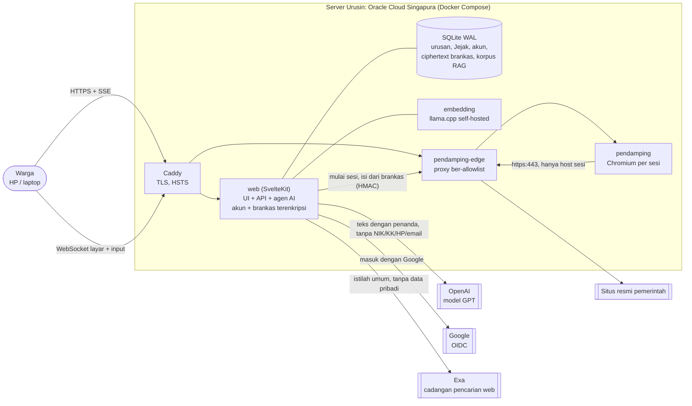

# Urusin

[](https://github.com/bynguts/urusin/actions/workflows/ci.yml)
[](https://github.com/bynguts/urusin/actions/workflows/release.yml)
[](https://github.com/bynguts/urusin/actions/workflows/security.yml)

**Urusin adalah asisten AI yang menemani warga mengurus layanan administrasi kependudukan, dari cerita pertama
sampai formulir di situs resmi terisi.** Warga cukup bercerita ("anak saya baru lahir di Wonogiri"). Urusin
menentukan layanan dan daerahnya, menyusun langkah dan daftar berkas dari sumber resmi, memeriksa foto dokumen,
lalu membantu mengisi formulir di portal pemerintah lewat **Browser Pendamping**. Login, OTP, CAPTCHA, dan tombol
**Kirim** terakhir selalu ditekan warga sendiri.

- **Aplikasi langsung:** <https://urusinai.web.id>
- **Video demo (YouTube, 3–5 menit):** **[TAUTAN VIDEO MENYUSUL]**
- **Akun demonstrasi:** halaman [Masuk](https://urusinai.web.id/masuk) → **Masuk sebagai juri**, tanpa kredensial
  (lihat [§7](#7-akun-demonstrasi)).
- **Kode sumber:** <https://github.com/bynguts/urusin> (repositori ini, lisensi MIT).

## Daftar isi

1. [Nama tim dan anggota](#1-nama-tim-dan-anggota)
2. [Kategori, aplikasi, masalah, solusi, dan target pengguna](#2-kategori-aplikasi-masalah-solusi-dan-target-pengguna)
3. [Fitur utama](#3-fitur-utama)
4. [Teknologi](#4-teknologi)
5. [Arsitektur sistem dan alur data](#5-arsitektur-sistem-dan-alur-data)
6. [Instalasi, konfigurasi, dan menjalankan](#6-instalasi-konfigurasi-dan-menjalankan)
7. [Akun demonstrasi](#7-akun-demonstrasi)
8. [Dokumentasi penggunaan AI](#8-dokumentasi-penggunaan-ai)
9. [Atribusi](#9-atribusi)
10. [Keamanan, privasi, dan etika](#10-keamanan-privasi-dan-etika)
11. [Pengujian dan CI](#11-pengujian-dan-ci)
12. [Status dan batasan](#12-status-dan-batasan)
13. [Dokumentasi lanjutan](#13-dokumentasi-lanjutan)

## 1. Nama tim dan anggota

**Tim Urusin**

| Peran                                                           | Anggota                        | Kampus                      | GitHub                                     |
| --------------------------------------------------------------- | ------------------------------ | --------------------------- | ------------------------------------------ |
| Ketua: agen AI, RAG, akun dan keamanan, Browser Pendamping, ops | Muhammad Muqorrobin Al Anshori | President University        | [@bynguts](https://github.com/bynguts)     |
| Anggota: desain UI/UX, adapter layanan dan kota, uji e2e        | Rafi Cahya Mahardika           | Universitas Negeri Surabaya | [@rafilajhh](https://github.com/rafilajhh) |

## 2. Kategori, aplikasi, masalah, solusi, dan target pengguna

- **Kategori:** Web (aplikasi web responsif, dirancang untuk HP lebih dulu, tanpa perlu memasang aplikasi).
- **Nama aplikasi:** Urusin.
- **Subtema:** 5. Civic Tech & Community Service.

### Masalah

- Indonesia punya 514 kabupaten/kota (`data/wilayah/kabkota.json`). Layanan administrasi kependudukan (akta
  kelahiran dan kematian, KK, KTP-el, pindah domisili) dilayani Disdukcapil masing-masing, dengan portal, syarat,
  dan alur yang berbeda-beda.
- Warga yang sedang mengalami peristiwa hidup harus mencari sendiri portal yang benar, membaca syarat yang
  tersebar, lalu mengisi formulir panjang. Ini paling berat bagi perantau yang KTP-nya masih di kampung, warga
  lansia, dan warga yang hanya punya HP.
- Kesalahan kecil (berkas kurang, foto buram, situs palsu, kolom salah) membuat warga bolak-balik ke kantor.

### Solusi

- **Bercerita, bukan mencari.** Urusin mengenali layanan dan daerah dari percakapan, lalu menyusun rencana
  langkah dan daftar berkas yang setiap klaimnya bersumber dari halaman resmi.
- **Data disimpan sekali, aman.** Data Diri dan dokumen disimpan terenkripsi; foto dokumen diperiksa AI supaya
  tidak ditolak petugas karena buram atau terpotong.
- **Formulir diisi bersama.** Browser Pendamping membuka situs resmi di server Urusin dan menampilkan layarnya di
  HP warga. AI mengisi kolom hanya setelah warga menekan **"Izinkan isi"**; warga sendiri yang login, menjawab
  CAPTCHA, memeriksa, dan menekan Kirim.
- **Tetap membantu di daerah mana pun.** Bila portal daerah belum bisa dibuka dari server, Urusin memandu warga
  langkah demi langkah dengan sumber dan kanal resmi, tanpa mengarang jawaban.

### Target pengguna

Perantau, keluarga yang sedang mengurus peristiwa hidup (kelahiran, kematian, perkawinan, pindah), dan warga
lansia lewat anggota keluarga yang mendampingi. Prioritas desainnya HP kelas menengah ke bawah dan koneksi lambat.

## 3. Fitur utama

Semua fitur di bawah sudah berjalan di <https://urusinai.web.id>.

- **Percakapan agen berbahasa Indonesia.**
  - Mulai dari Peristiwa Hidup (Kelahiran, Kematian, Perkawinan, Pindah domisili) atau langsung bercerita.
  - Agen menanyakan yang kurang, mengusulkan rencana, dan meminta persetujuan sebelum mengisi apa pun.
  - Kartu wilayah muncul saat daerah perlu dipastikan, bukan sebagai pembuka percakapan.
  - Jawaban dialirkan bertahap (SSE). Pertanyaan di luar urusan layanan publik ditolak dengan sopan
    (_guardrail_ di luar topik).
- **Jawaban bersumber resmi.**
  - Pencarian kata kunci (BM25 + glosarium istilah warga) atas korpus halaman resmi Dukcapil, Disdukcapil
    daerah, dan regulasi, di server Urusin sendiri.
  - Bila korpus belum cukup, agen memakai pencarian web Exa sebagai cadangan: situs resmi `.go.id` lebih dulu,
    istilah umum saja (kueri yang memuat NIK, KK, HP, atau email tidak pernah dikirim).
  - Setiap klaim membawa kutipan yang diverifikasi terhadap potongan sumbernya; chip kutipan membuka halaman
    resmi.
  - Bila sumber tidak cukup, agen **abstain** dan mengarahkan ke kanal resmi daerah.
- **Router 514 kabupaten/kota.** Daerah ditentukan dari pilihan warga atau kode wilayah, lengkap dengan kontak
  Disdukcapil dan status dukungan portal tiap daerah.
- **Pemeriksaan foto dokumen (AI vision).** Foto yang dilampirkan di chat atau disimpan di Dokumen diperiksa:
  buram, terpotong, gelap, silau, miring, atau tertutup. Urusin menyebut bagian mana yang perlu difoto ulang. PDF
  tidak dikirim ke AI.
- **Browser Pendamping.**
  - Satu Chromium per sesi di server Urusin; layarnya dialirkan ke HP atau laptop warga, jadi tidak perlu
    memasang apa pun.
  - **Live 24/7 di 8 kota/kabupaten:** Surabaya, Wonogiri, Malang, Depok, Kota Tangerang, Padang, Bandar Lampung,
    dan Banjarmasin.
  - Medan dan Semarang: portalnya hanya menerima jaringan Indonesia, jadi Urusin memandu warga langkah demi
    langkah. Daerah lain mendapat mode dipandu dengan sumber resmi.
  - AI mengisi kolom hanya setelah **"Izinkan isi"**. Login, OTP, CAPTCHA, dan Kirim selalu dikerjakan warga lewat
    "ambil alih".
- **Cek status permohonan (baca saja)** untuk portal Surabaya, berjalan sampai halaman yang meminta login atau
  CAPTCHA warga.
- **"Izinkan isi".** Sebelum mengisi, warga melihat data apa yang akan ditulis ke situs mana. Persetujuan berlaku
  sekali, hanya untuk situs itu, dan nilainya diambil server langsung dari brankas, tidak lewat model AI.
- **Akun.** Daftar dengan email + kata sandi atau masuk dengan Google. Data Diri, dokumen, dan daftar urusan ikut
  ke perangkat lain. Di **Pengaturan → Keluar dan hapus akun** warga bisa keluar dari semua perangkat atau
  menghapus akun beserta datanya.
- **Brankas terenkripsi.** Data Diri (NIK, KK, alamat, HP) dan dokumen dienkripsi AES-256-GCM dengan kunci per
  pemilik. Menghapus akun menghancurkan kuncinya (_crypto-shred_).
- **Jejak.** Linimasa setiap urusan (`/jejak/<id>`) dari log audit berantai hash; bila rantainya tidak utuh,
  Jejak menandainya rusak.
- **Aksesibilitas.**
  - Tombol **Bicara** untuk dikte suara dan tombol **Bacakan** untuk membacakan teks.
  - Teks besar, target sentuh lebar, mode terang/gelap.
- **Navigasi sederhana:** Beranda, Urusanku, Dokumen, Bantuan, dan Pengaturan.

## 4. Teknologi

| Lapisan              | Yang dipakai                                                                                                                 |
| -------------------- | ---------------------------------------------------------------------------------------------------------------------------- |
| Bahasa dan monorepo  | TypeScript (strict), Node.js 26, pnpm 11, Turborepo                                                                          |
| Web (UI + API)       | SvelteKit 3 + Svelte 5, `@sveltejs/adapter-node`, Vite 8, Tailwind CSS 4                                                     |
| Agen AI              | Harness buatan sendiri di atas Chat Completions (`@urusin/harness`): state machine urusan, tool bertipe zod, policy gate     |
| AI                   | OpenAI (model GPT) lewat SDK resmi `openai`; EmbeddingGemma-300M self-hosted (llama.cpp) untuk mengenali jenis urusan        |
| Browser Pendamping   | Chromium via Playwright, screencast CDP → WebSocket → `<canvas>`; adapter situs (Step DSL) dan Navigator generik             |
| Basis data           | SQLite (`better-sqlite3`, mode WAL); pencarian BM25 lewat FTS5                                                               |
| Kriptografi dan akun | `node:crypto` (argon2id, AES-256-GCM, HKDF), `jose` (verifikasi ID token Google OIDC)                                        |
| Validasi dan kontrak | zod 4, `@urusin/contracts` (skema event SSE dan endpoint)                                                                    |
| HTTP keluar          | `undici` dengan allowlist host (`@urusin/egress`): semua panggilan keluar server lewat satu pintu                            |
| Situs latihan        | Hono (`apps/fixtures`): replika jinak portal daerah untuk uji e2e                                                            |
| Pengujian            | Vitest, Playwright, `node:test`, Lighthouse CI                                                                               |
| Kualitas             | ESLint, Prettier, commitlint, husky (pemindai PII/secret sebelum commit)                                                     |
| CI/CD dan hosting    | GitHub Actions, image multi-arch di GHCR ditarik berdasarkan digest, Docker Compose di Oracle Cloud (Singapura), Caddy (TLS) |
| Layanan pihak ketiga | OpenAI (model GPT), Exa (cadangan pencarian web), Google Identity (masuk dengan Google), GitHub Actions/GHCR, Oracle Cloud   |

## 5. Arsitektur sistem dan alur data



**Alur satu urusan:**

1. Warga bercerita. Agen menentukan layanan dan daerah, lalu mencari syarat di korpus sumber resmi (BM25, di
   server Urusin sendiri; cadangan pencarian web Exa ke situs resmi bila korpus belum cukup).
2. Sebelum teks dikirim ke model, NIK, KK, nomor HP, dan email diganti penanda seperti `{{PEMOHON.NIK}}`. Teks
   dari halaman web dan hasil tool masuk ke prompt sebagai data tak tepercaya. Guard `noPlaceholder()` dan policy
   gate menolak parameter tool yang memuat PII atau aksi di luar tahap urusan.
3. Agen menyusun rencana dan daftar berkas dengan kutipan sumber. Foto dokumen diperiksa kejelasannya.
4. Untuk mengisi formulir, warga menekan **"Izinkan isi"**. Server menerbitkan persetujuan sekali pakai yang
   terikat pemilik, daftar kolom, dan origin situs.
5. Browser Pendamping membuka situs resmi. Kolom diisi dengan nilai dari brankas, hanya bila origin halaman sama
   persis dengan origin persetujuan. Login, OTP, CAPTCHA, dan Kirim dikerjakan warga; runner menolak mengklik
   tombol final.
6. Setiap langkah dicatat di Jejak (log audit berantai hash).

Detail C4 dan diagram urutan PII ada di [`docs/arsitektur.md`](docs/arsitektur.md).

| Bagian                                     | Lokasi                                                                                                          |
| ------------------------------------------ | --------------------------------------------------------------------------------------------------------------- |
| Web app, API, broker sesi Pendamping       | `apps/web`                                                                                                      |
| Browser Pendamping                         | `apps/pendamping`, `packages/executor`, `packages/adapters`, `packages/navigator`, `packages/pendamping-client` |
| Sidecar embedding                          | `apps/embedding` (Dockerfile), `packages/embedding`                                                             |
| Situs latihan                              | `apps/fixtures`                                                                                                 |
| Agen, state machine, eval                  | `packages/harness`                                                                                              |
| Akun, sesi, brankas                        | `packages/akun`                                                                                                 |
| Pencarian sumber resmi (RAG)               | `packages/rag`, data di `data/`                                                                                 |
| Router kabupaten/kota                      | `packages/registry`                                                                                             |
| Gateway LLM                                | `packages/llm`                                                                                                  |
| Allowlist HTTP keluar                      | `packages/egress`                                                                                               |
| Step DSL, guard PII, registry domain resmi | `packages/core`                                                                                                 |
| Kontrak API/SSE                            | `packages/contracts`                                                                                            |
| Deploy                                     | `deploy/` (Compose, snippet Caddy, skrip deploy dan backup)                                                     |

## 6. Instalasi, konfigurasi, dan menjalankan

### Prasyarat

- Node.js 26 (lihat `.nvmrc`) dan pnpm 11 (`corepack enable` atau `npm i -g pnpm@11`).
- Opsional untuk e2e: Chromium Playwright (`pnpm exec playwright install chromium`).
- Opsional untuk demo lengkap satu perintah: Docker dengan Compose v2 dan bash (Git Bash di Windows).

### Menjalankan untuk pengembangan

```bash
git clone https://github.com/bynguts/urusin.git
cd urusin
pnpm install --frozen-lockfile   # memasang dependensi dan hook commit
cp .env.example .env             # isi nilai sendiri; .env diabaikan git dan tidak pernah di-commit
pnpm build                       # build semua paket workspace
pnpm --filter @urusin/web dev    # http://localhost:5173
```

Isi `URUSIN_PII_KEY` di `.env` dengan kunci acak 32 byte (base64), misalnya hasil
`node -e "console.log(require('crypto').randomBytes(32).toString('base64'))"`.

Tanpa kunci LLM aplikasi tetap berjalan: agen memakai `DemoProvider` (skenario tetap, tanpa jaringan) dan
pencarian memakai BM25 saja.

### Variabel lingkungan

Daftar lengkap beserta penjelasan tiap variabel ada di [`.env.example`](.env.example). Yang utama:

| Fitur                      | Variabel                                                                                                 |
| -------------------------- | -------------------------------------------------------------------------------------------------------- |
| Agen dengan LLM            | `LLM_BASE_URL`, `LLM_API_KEY`, `LLM_AGENT_MODEL`, `LLM_VISION_MODEL`                                     |
| Pencarian dan embedding    | `URUSIN_EMBED_URL` (sidecar llama.cpp), `EXA_API_KEY` (cadangan web), `RAG_ABSTAIN_MIN_*`, `LLM_EMBED_*` |
| Brankas dan akun           | `URUSIN_PII_KEY` (wajib di produksi), `URUSIN_PII_KEY_PREV` (rotasi), `SESSION_SECRET`, `URUSIN_VAULT_*` |
| Masuk dengan Google        | `GOOGLE_CLIENT_ID`, `GOOGLE_CLIENT_SECRET`                                                               |
| Kuota dan biaya            | `URUSIN_LIMIT_*`, `URUSIN_DEMO_*`, `URUSIN_DAILY_USD_CAP`, `URUSIN_DAILY_IDR_CAP`                        |
| Browser Pendamping         | `PENDAMPING_*` (URL worker, rahasia HMAC, batas sesi dan memori)                                         |
| Situs latihan              | `FIXTURES_PROFILE`, `FIXTURES_PORT`, `FIXTURES_PUBLIC_ORIGIN`                                            |
| Opsional, mati di produksi | `RESEND_API_KEY`, `URUSIN_EMAIL_*`, `TURNSTILE_*`, `RERANK_*`, `VAPID_*`                                 |

### Demo lengkap di localhost (Docker, satu perintah)

Web + Browser Pendamping + situs latihan + akun juri di satu laptop:

```bash
bash scripts/demo-final.sh up    # build image, naikkan di http://localhost, lalu preflight
```

| Perintah                               | Kegunaan                                                       |
| -------------------------------------- | -------------------------------------------------------------- |
| `bash scripts/demo-final.sh cek`       | Preflight: layanan, waktu respons, LLM, RAG, Pendamping, juri  |
| `bash scripts/demo-final.sh offline`   | Matikan LLM; agen memakai `DemoProvider` (bila internet putus) |
| `bash scripts/demo-final.sh online`    | Kembali memakai LLM                                            |
| `bash scripts/demo-final.sh log web`   | Log satu layanan                                               |
| `bash scripts/demo-final.sh down`      | Hentikan (data demo tetap); `reset` menghapus juga data demo   |
| `bash scripts/demo-final.sh up --ghcr` | Tarik image dari GHCR alih-alih build                          |

LLM untuk demo diambil dari env `LLM_BASE_URL`, `LLM_API_KEY`, dan `LLM_AGENT_MODEL` saat `up`; tanpa itu demo
memakai `DemoProvider`. Topologi: [`deploy/compose.demo.yml`](deploy/compose.demo.yml).

### Pemeriksaan

```bash
pnpm lint && pnpm typecheck && pnpm test   # sama dengan CI
pnpm format:check                          # Prettier
pnpm e2e                                   # Playwright (web dan Browser Pendamping terhadap situs latihan)
pnpm coverage                              # coverage per paket dengan ambang
pnpm budget                                # anggaran JS awal per rute
pnpm audit:history                         # riwayat commit: konvensional, author terdaftar, tanpa atribusi AI
```

Deploy produksi (image GHCR berdasarkan digest, blue/green di belakang Caddy) dijelaskan di
[`deploy/README.md`](deploy/README.md).

## 7. Akun demonstrasi

Juri **tidak butuh kredensial**:

1. Buka <https://urusinai.web.id/masuk> → **Masuk sebagai juri** ("Coba data contoh tanpa daftar").
2. Urusin membuat salinan demo terisolasi berisi Data Diri karangan (bukan data orang sungguhan). Setiap klik
   mendapat salinannya sendiri, jadi juri tidak saling menimpa data. Salinan terhapus otomatis setelah 24 jam.
3. Browser Pendamping untuk akun juri berjalan dalam **mode demo**: AI membuka dan menavigasi situs resmi yang
   asli **hanya untuk dilihat**, tanpa mengisi apa pun. Untuk melihat cara pengisian, pilih **"Lihat contoh
   pengisian (simulasi)"**.

Tidak ada sandi demo yang dipublikasikan. Akun di situs pemerintah selalu milik warga sendiri dan tidak pernah
dibagikan.

## 8. Dokumentasi penggunaan AI

### AI di dalam produk

| Bagian produk                                    | Layanan / model                                                                                   |
| ------------------------------------------------ | ------------------------------------------------------------------------------------------------- |
| Agen percakapan: niat, rencana, pemanggilan tool | OpenAI (model GPT) lewat gateway `@urusin/llm` (SDK `openai`)                                     |
| Pemeriksaan foto dokumen dan lampiran chat       | OpenAI (model GPT, multimodal); salinan gambar diperkecil, PDF tidak dikirim                      |
| Navigator Browser Pendamping                     | OpenAI (model GPT) memetakan kolom formulir ke penanda data; nilai asli diisi server dari brankas |
| Pengenalan jenis urusan (cepat)                  | Embedding open-source EmbeddingGemma-300M self-hosted (llama.cpp) di server Urusin                |
| Pencarian sumber resmi                           | BM25 di server Urusin; cadangan pencarian web Exa (istilah umum, situs `.go.id` lebih dulu)       |

- **Model tidak pernah menerima NIK, KK, nomor HP, atau email.** Semuanya diganti penanda sebelum dikirim, dan
  hasil bacaan gambar disaring lagi sebelum masuk konteks agen.
- **Konten luar dianggap data, bukan perintah.** Teks halaman, hasil pencarian, dan isi berkas dibungkus
  penanda (_spotlighting_). Suite uji prompt injection (`packages/harness/src/injection`) dijalankan dengan model
  tiruan yang sengaja patuh; aksi tulis dan final tetap diblokir policy gate.
- **Guardrail:** permintaan di luar urusan layanan publik ditolak tanpa memanggil model; jawaban tanpa sumber
  yang cukup diganti abstain dan rujukan ke kanal resmi.
- **Kendali biaya:** pemakaian token dicatat per urusan dan dibatasi harian (`URUSIN_DAILY_*_CAP`); bila AI tidak
  tersedia, aplikasi turun ke mode hemat atau langkah dari sumber resmi.
- **Evaluasi:** eval agen (`pnpm eval`), eval retrieval (`pnpm rag:eval`), dan eval persona warga lintas daerah
  (`scripts/eval-persona`, laporan di folder yang sama).
- **Dikte suara:** tombol Bicara memakai Web Speech bawaan peramban. Di Chrome, suara diproses layanan Google
  menjadi teks; Urusin hanya menerima teksnya.

### AI saat pengembangan

- Kami memakai AI coding assistant untuk membantu menulis dan meninjau kode, tes, konfigurasi, dan dokumentasi.
- Setiap perubahan ditinjau, diuji, dan di-commit oleh anggota tim dari akun GitHub masing-masing; tim
  bertanggung jawab penuh atas seluruh kode.
- Trailer co-author otomatis dimatikan ([ADR 0027](docs/adr/0027-commit-konvensional-tanpa-co-author.md));
  penggunaan AI diungkap di bagian ini.

## 9. Atribusi

- **Dataset:**
  - Kode dan nama wilayah: Kepmendagri 300.2.2-2138 Tahun 2025 (diubah dengan 300.2.2-2430/2025), diambil lewat
    mirror [cahyadsn/wilayah](https://github.com/cahyadsn/wilayah) (MIT) dan dicocokkan dengan
    [yonatanyl/KODE-WILAYAH-KEPMENDAGRI-2025](https://github.com/yonatanyl/KODE-WILAYAH-KEPMENDAGRI-2025). Detail
    di `data/wilayah/kabkota.json`.
  - Korpus sumber resmi: halaman dan dokumen resmi (Dukcapil, Disdukcapil daerah, regulasi) beserta URL dan
    tanggal aksesnya di `data/sources.json`.
  - Kontak Disdukcapil: `data/wilayah/kontak-dukcapil.json`, dengan URL sumber per entri.
  - Glosarium istilah: `data/glossary/`, merujuk sumber di `data/sources.json`.
- **Aset desain:** desain UI, token, ilustrasi maskot, dan logo dibuat oleh Rafi Cahya Mahardika di pen.dev; font
  Strawberry Sans sebagai bagian design system tim.
- **Pustaka sumber terbuka utama:** SvelteKit, Svelte, Vite, Tailwind CSS, Playwright, Hono, better-sqlite3, zod,
  `openai` (SDK resmi), jose, undici, llama.cpp (MIT), Turborepo, Vitest, ESLint, Prettier, commitlint, husky. Versi
  lengkap ada di `pnpm-lock.yaml`.
- **Model open-source:** EmbeddingGemma-300M (`google/embeddinggemma-300m`, konversi GGUF Q8_0 oleh ggml-org),
  tunduk pada [Gemma Terms of Use](https://ai.google.dev/gemma/terms); lihat
  [`apps/embedding/NOTICE`](apps/embedding/NOTICE).
- **Layanan pihak ketiga:** OpenAI (model GPT), Exa (cadangan pencarian web), Google Identity (OIDC), GitHub
  Actions dan GHCR, Oracle Cloud.
- Tidak memakai template proyek pihak ketiga.

## 10. Keamanan, privasi, dan etika

- **Warga yang memegang kendali.**
  - Agen tidak pernah menekan Kirim, login, atau menyelesaikan CAPTCHA. Tanpa plugin stealth, tanpa layanan
    pemecah CAPTCHA, tanpa proxy residensial, dan user agent jujur
    ([ADR 0025](docs/adr/0025-executor-tanpa-bypass-captcha.md)).
  - AI mengisi hanya setelah "Izinkan isi", untuk satu situs dan satu kali.
- **Perlindungan data (UU PDP 27/2022).**
  - Data Diri dan dokumen dienkripsi AES-256-GCM dengan kunci per pemilik; kata sandi di-hash argon2id.
  - NIK, KK, HP, dan email diganti penanda sebelum teks dikirim ke model AI.
  - Hak akses, perbaikan, dan penghapusan lewat UI: Data Diri, Dokumen, dan **Pengaturan → Keluar dan hapus
    akun**. Hapus akun menghancurkan kunci brankas.
  - Server di Oracle Cloud region Singapura. Cadangan basis data dibuat tiap 6 jam dan disimpan 3 hari.
  - Tanpa iklan, tanpa pelacak, tanpa analitik pihak ketiga. Kebijakan privasi lengkap, termasuk daftar pemroses
    dan transfer lintas negara: [`docs/privasi.md`](docs/privasi.md).
- **Akun.** Sesi di cookie `__Host-` (HttpOnly, Secure, SameSite=Lax), server hanya menyimpan hash token, kunci
  bertahap setelah gagal masuk, dan Google OIDC dengan PKCE/state/nonce.
- **Browser Pendamping.**
  - Konteks Chromium non-persisten per sesi, dihancurkan setelah selesai, 15 menit, atau 3 menit idle. Layar
    tidak direkam; ketikan warga saat ambil alih tidak dicatat dan tidak dikirim ke AI.
  - Kontainer tanpa rute keluar selain proxy edge yang hanya mengizinkan https:443 ke host sesi dan menolak alamat
    privat/metadata. Sandbox Chromium aktif, kontainer non-root, filesystem read-only
    ([ADR 0029](docs/adr/0029-browser-pendamping.md)).
- **Web.** CSP SvelteKit mode `auto` (nonce/hash), `frame-ancestors 'none'`, dan semua HTTP keluar lewat
  allowlist `@urusin/egress`.
- **Rantai pasok.** Semua GitHub Action dipin ke SHA; OSV-Scanner, `pnpm audit --prod`, CodeQL, dan OpenSSF
  Scorecard; hook pre-commit dan CI memindai NIK, HP, email, dan private key. Rahasia hanya di `.env` (diabaikan
  git), dengan [`.env.example`](.env.example) berisi nama variabel tanpa nilai asli.
- Kebijakan pelaporan kerentanan: [`SECURITY.md`](SECURITY.md).

## 11. Pengujian dan CI

- Tes unit Vitest di setiap paket, tes `node:test` untuk skrip repositori, dan e2e Playwright (alur akun, juri,
  alur utama di layar HP dan desktop, serta Browser Pendamping terhadap situs latihan, tidak pernah situs
  pemerintah asli).
- **CI ([`.github/workflows/ci.yml`](.github/workflows/ci.yml)):** lint, format, typecheck, test, build; anggaran
  bundle; audit riwayat commit (konvensional, author terdaftar, tanpa atribusi AI); pemindai PII; e2e; coverage
  dengan ambang per paket; Lighthouse CI mobile; dan pembekuan kontrak API.
- **Release:** setiap push ke `main` membangun image `linux/amd64` + `linux/arm64` ke GHCR. Server menarik image
  berdasarkan digest dan memeriksa `/api/health` sebelum mengalihkan trafik.
- **Versi yang berjalan** bisa dicek di field `versi` pada <https://urusinai.web.id/api/kemampuan>.

## 12. Status dan batasan

Status per 14 November 2026:

| Bagian                                                           | Status                                                                  |
| ---------------------------------------------------------------- | ----------------------------------------------------------------------- |
| Percakapan agen, pencarian sumber resmi, router 514 kab/kota     | Live                                                                    |
| Pemeriksaan foto dokumen (vision)                                | Live                                                                    |
| Akun (email + sandi, Google), Masuk sebagai juri, brankas, Jejak | Live                                                                    |
| Browser Pendamping                                               | Live 24/7 di 8 kota/kabupaten; Medan, Semarang, dan daerah lain dipandu |
| Cek status permohonan (baca saja)                                | Live untuk Surabaya                                                     |

Batasan yang kami tulis apa adanya:

- **Jangkauan portal.** Pengisian otomatis baru tersedia di 8 daerah di atas. Portal yang hanya menerima jaringan
  Indonesia (Medan, Semarang) belum bisa dibuka dari server di Singapura, sehingga di sana Urusin memandu warga
  langkah demi langkah. Daerah lain mendapat mode dipandu dengan sumber dan kanal resmi.
- **Kirim tetap manual, sengaja.** Urusin tidak akan pernah menekan Kirim atau menjawab CAPTCHA atas nama warga.
- **Email belum dikirim.** Urusin saat ini tidak mengirim email, jadi atur ulang kata sandi lewat email belum
  tersedia. Masuk dengan Google tetap bisa dipakai sebagai cara masuk alternatif.
- **Persetujuan "Izinkan isi"** disimpan di memori proses; bila server dimulai ulang, warga cukup menekannya lagi.
- **Akun juri** hanya membuka situs resmi untuk dilihat; contoh pengisian ditampilkan sebagai simulasi agar data
  karangan tidak pernah terkirim ke situs pemerintah.

## 13. Dokumentasi lanjutan

- [Arsitektur (C4 dan alur data PII)](docs/arsitektur.md)
- [Kebijakan privasi](docs/privasi.md)
- [Kebijakan keamanan](SECURITY.md) (Indonesia dan English)
- [Architecture Decision Records](docs/adr/README.md) (riwayat keputusan; ADR lama yang sudah digantikan tetap
  disimpan sebagai catatan)
- [Deploy di server](deploy/README.md)
- [Kontrak API/SSE](packages/contracts/README.md)

## Lisensi

[MIT](LICENSE) © 2026 Tim Urusin
