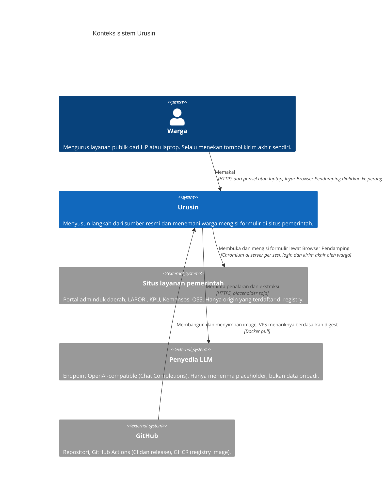
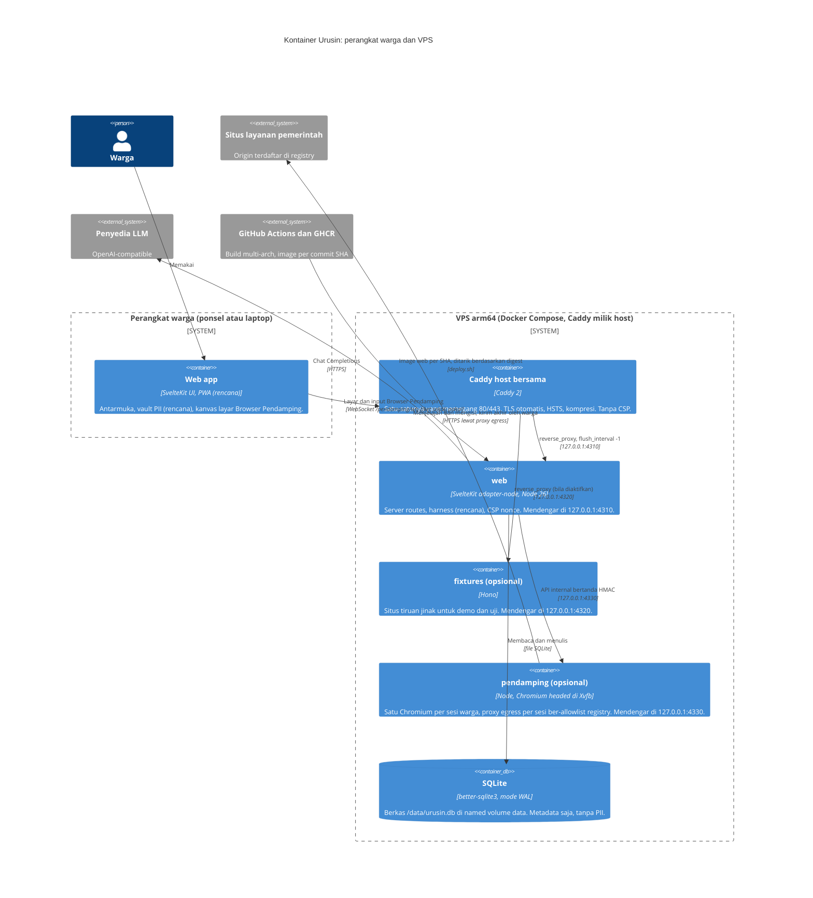
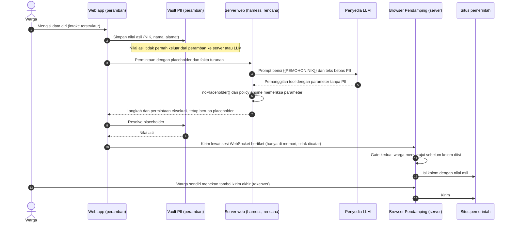

# Arsitektur Urusin

Dokumen ini menggambarkan topologi **yang ada saat ini** di repositori dan di `deploy/`. Bagian yang masih
rencana ditandai **(rencana)** dan tidak digambar sebagai komponen yang sudah berjalan. Keputusan di balik
bentuk ini dicatat di [`docs/adr/`](adr/README.md); ancaman dan mitigasinya ada di rencana §6.2.

Diagram memakai sintaks C4 Mermaid (`C4Context`, `C4Container`) yang dirender langsung oleh GitHub. Sintaks C4
di Mermaid masih berstatus eksperimental, sehingga tata letak otomatisnya bisa berbeda antar-versi renderer.

## 1. Konteks sistem (C4 level 1)

## 2. Kontainer (C4 level 2)

Catatan pembacaan:

- **Caddy dimiliki host**, bukan service di `compose.prod.yml`. Snippet `deploy/Caddyfile.urusin.primary` (atau `.fallback`) di-`import`
  ke Caddyfile host yang juga melayani situs lain. Compose hanya mempublikasikan port loopback.
  Alasannya ada di [ADR 0023](adr/0023-caddy-host-bersama-port-loopback.md).
- `{$DOMAIN}` dan `verify.{$DOMAIN}` menuju upstream yang sama (`127.0.0.1:4310`). Aplikasi memilih rute `/verify`
  dari header `Host` mentah.
- Container `web` berjalan `read_only`, `cap_drop: [ALL]`, `no-new-privileges`, `mem_limit: 512m`.
- **Belum ada (rencana):** harness agen, tujuh server MCP, vault PII, service `worker` pengingat, service `backup`,
  PWA. Repositori baru memuat fondasi, fixtures, dan paket `core`, `llm`, `registry`, `rag`.
- Paket pustaka (bukan kontainer): `@urusin/core` (Step DSL, guard placeholder, registry domain),
  `@urusin/llm` (gateway dan capability probe), `@urusin/registry` (router kab/kota dari prefiks NIK),
  `@urusin/rag` (BM25 FTS5, vektor opsional, fusi RRF).

## 3. Pipeline pengiriman

| Tahap       | Yang terjadi                                                                                                                           |
| ----------- | -------------------------------------------------------------------------------------------------------------------------------------- |
| CI          | `.github/workflows/ci.yml`: lint, format, typecheck, test, build, anggaran bundle, audit riwayat commit.                               |
| Release     | `.github/workflows/release.yml`: push ke `main` membangun image web `linux/amd64` dan `linux/arm64`, push ke GHCR.                     |
| Digest      | Digest image dicatat di ringkasan job. Tag hanya SHA commit.                                                                           |
| Deploy      | `deploy/deploy.sh <sha> [digest]` menarik image berdasarkan digest, `up -d`, lalu menunggu `/api/health` dan memastikan `gitSha` sama. |
| Tidak build | VPS tidak pernah membangun image.                                                                                                      |

## 4. Alur data PII

Invarian utama (rencana §3.1): semua yang melintasi garis peramban ke server bebas PII. Model hanya melihat
**placeholder** seperti `{{PEMOHON.NIK}}`. Nilai asli hanya ada di vault peramban dan baru diganti di sisi
eksekutor (Browser Pendamping), sesaat sebelum mengisi kolom di situs pemerintah. Guard `noPlaceholder()` menolak parameter
dari model yang memuat `{{`, `}}`, atau pola NIK, HP, dan email.

Pengecualian yang disetujui di rencana (belum diimplementasikan): dua jalur pass-through `/api/vision` (gambar
yang sudah di-masking) dan `/api/transcribe` (audio). Keduanya tidak disimpan dan tidak dicatat. Risiko sisa
(JS dari server yang bisa membaca vault bila server dibobol) diungkap di threat model.

## 5. Jejak keputusan

Daftar ADR ada di [`docs/adr/README.md`](adr/README.md).
