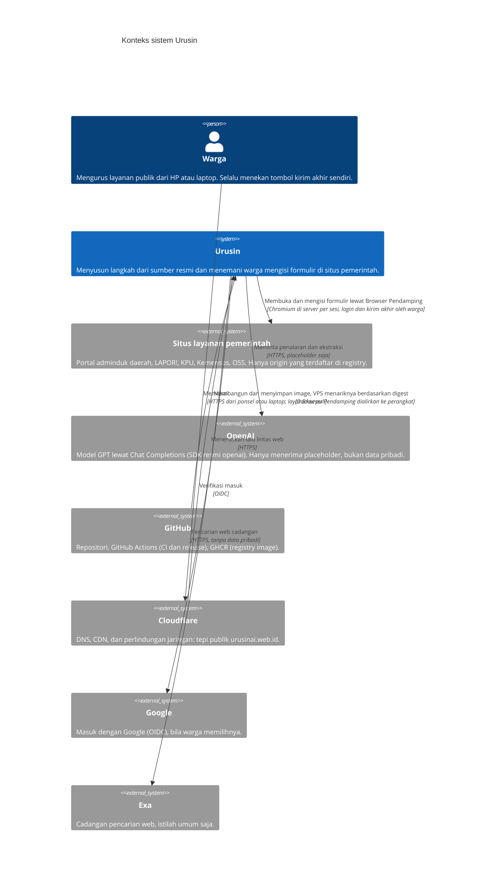
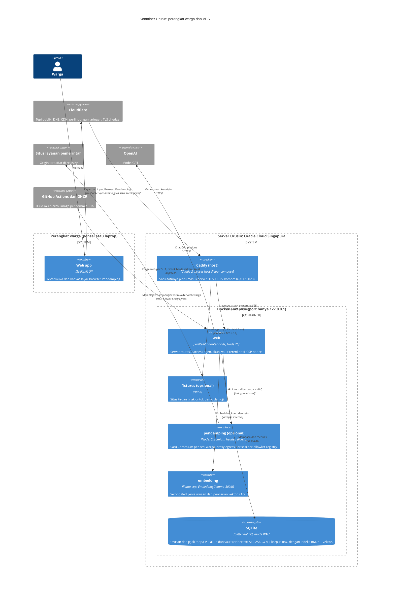
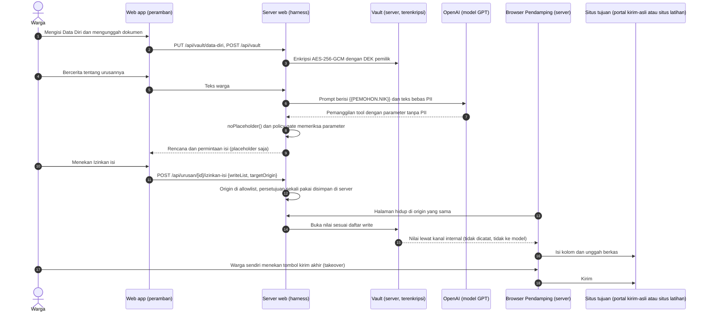

# Arsitektur Urusin

Dokumen ini menggambarkan topologi **yang ada saat ini** di repositori dan di `deploy/`. Bagian yang masih
rencana ditandai **(rencana)** dan tidak digambar sebagai komponen yang sudah berjalan. Keputusan di balik
bentuk ini dicatat di [`docs/adr/`](adr/README.md).

Diagram memakai sintaks C4 Mermaid (`C4Context`, `C4Container`) yang dirender langsung oleh GitHub. Sintaks C4
di Mermaid masih berstatus eksperimental, sehingga tata letak otomatisnya bisa berbeda antar-versi renderer.

## 1. Konteks sistem (C4 level 1)

## 2. Kontainer (C4 level 2)

Catatan pembacaan:

- **Cloudflare adalah tepi publik.** DNS urusinai.web.id ada di Cloudflare dan semua lalu lintas web diproksikan
  lewat jaringannya (CDN, perlindungan jaringan, TLS di edge). Di server, **Caddy milik host adalah satu-satunya
  pintu masuk**: Caddy berjalan sebagai proses host, bukan di Docker Compose, dan kontainer Urusin hanya mengikat
  port loopback `127.0.0.1`. Alasannya ada di [ADR 0023](adr/0023-caddy-host-bersama-port-loopback.md).
- Container `web` berjalan `read_only`, `cap_drop: [ALL]`, `no-new-privileges`, `mem_limit: 512m`.
- **Belum ada (rencana):** server MCP, service `worker` pengingat, PWA. Pengingat masih dimatikan lewat
  flag.
- **Penyimpanan data pribadi ([ADR 0028](adr/0028-akun-dan-login.md)):**
  - Tidak ada mode tamu: akun wajib. Data tamu lama (sebelum akun wajib) digabung ke akun saat masuk dari
    peramban yang sama, lalu disapu. Daftar urusan disimpan di server per akun.
  - Dengan akun: vault terenkripsi per akun (DEK per pemilik dibungkus KEK dari `URUSIN_PII_KEY`) ikut lintas
    perangkat.
  - Salinan demo juri disimpan 24 jam; akun tidak disapu (tanpa verifikasi email, ADR 0032). Hapus = crypto-shred.
- **Pemroses dan lokasi** (sama dengan [`docs/privasi.md`](privasi.md)):
  - Oracle Cloud (Singapura): DB, berkas vault terenkripsi, pencarian sumber resmi, dan Browser Pendamping.
  - Cloudflare (global, titik terdekat Singapura): DNS, CDN, dan perlindungan jaringan untuk semua lalu lintas web,
    serta penerusan email ke hello@urusinai.web.id <!-- pii-scan:allow alamat kontak publik -->. Data Diri dan dokumen tetap tersimpan terenkripsi hanya di
    server Urusin.
  - Google: hanya untuk OIDC, bila warga memilihnya.
  - OpenAI (model GPT): teks percakapan dengan penanda; model tidak pernah melihat NIK, KK, HP, atau email.
  - Exa (Amerika Serikat): cadangan pencarian web, istilah umum tanpa data pribadi.
- Paket pustaka (bukan kontainer): `@urusin/harness` (agen, state machine, policy gate, audit), `@urusin/akun`
  (akun, sesi, vault), `@urusin/egress` (allowlist HTTP keluar), `@urusin/core` (Step DSL, guard placeholder, registry domain),
  `@urusin/llm` (gateway dan capability probe), `@urusin/registry` (router kab/kota dari prefiks NIK),
  `@urusin/rag` (BM25 FTS5 + vektor EmbeddingGemma, fusi RRF).

## 3. Pipeline pengiriman

| Tahap       | Yang terjadi                                                                                                                           |
| ----------- | -------------------------------------------------------------------------------------------------------------------------------------- |
| CI          | `.github/workflows/ci.yml`: lint, format, typecheck, test, build, anggaran bundle, audit riwayat commit.                               |
| Release     | `.github/workflows/release.yml`: push ke `main` membangun image web `linux/amd64` dan `linux/arm64`, push ke GHCR.                     |
| Digest      | Digest image dicatat di ringkasan job. Tag hanya SHA commit.                                                                           |
| Deploy      | `deploy/deploy.sh <sha> [digest]` menarik image berdasarkan digest, `up -d`, lalu menunggu `/api/health` dan memastikan `gitSha` sama. |
| Tidak build | VPS tidak pernah membangun image.                                                                                                      |

## 4. Alur data PII

Invarian utama: model dan log tidak pernah menerima PII mentah.

- Model hanya melihat **placeholder** seperti `{{PEMOHON.NIK}}`.
- Nilai asli ada di vault server yang terenkripsi. Vault hanya dibuka oleh jalur isi Pendamping
  (`lib/server/vault/resolver.ts`, satu-satunya penyelesai), setelah warga menekan "Izinkan isi" dan sesaat
  sebelum mengisi kolom di situs tujuan.
- Peramban tidak pernah menerima nilai vault untuk Pendamping.
- Guard `noPlaceholder()` menolak parameter dari model yang memuat `{{`, `}}`, atau pola NIK, HP, dan email.

Risiko sisa yang diungkap di ADR 0028: demi sinkron lintas perangkat, server memegang ciphertext sekaligus
kuncinya. Karena itu `URUSIN_PII_KEY` adalah rahasia paling kritis, dengan escrow dan rotasi lewat
`pnpm kek:rotate`.

## 5. Jejak keputusan

Daftar ADR ada di [`docs/adr/README.md`](adr/README.md).
